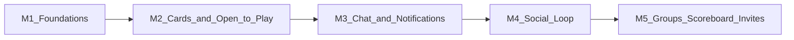

# PlayTT Community — Implementation Plan

Single source of truth for the Community feature across the API (repo root) and mobile (`playtt-mobile/`).

## Goal

A player taps **Open to play**, shows up in a list of available players near them, finds someone at the right skill level, **chats in the app** to agree on a time, and then books a table through the normal booking flow. Around that loop: following, Rally Partners, kudos, reliability, at-the-venue presence, group chats for doubles and events, scoreboard head-to-head, and WhatsApp invites.

### Product rules
1. **Community never reserves tables.** Times are agreed in chat. Tables are only held through the existing booking flow (`src/server/bookings`), so community activity can never block venue bookings.
2. **Opt-in and private by default.** Players appear only after turning on a community profile. Names show as first name + last initial. Location is the home venue, never GPS.
3. **Every number is real.** Card stats come from bookings, scoreboard matches and kudos. See [player-card.md](./player-card.md).

## Phase map

All milestones below are in scope for this release and are built in order.



| Milestone | Deliverable | Includes |
|-----------|-------------|----------|
| **M1** | Data model + API | Community profiles, usual times, open-to-play status, follows, blocks, reports |
| **M2** | Player cards + Community tab | Card component, Open to Play grid, filters, player profile, followers/following |
| **M3** | Chat | 1:1 chat, message requests, quick replies, Share booking card, push + unread badges |
| **M4** | Social loop | At the venue now, Rally Partners, kudos, reliability, post-match "Play again" |
| **M5** | Groups, scoreboard, growth | Doubles/event group chats, scoreboard head-to-head + rating, WhatsApp invites, card sharing |

## Decisions (defaults chosen)

| Question | Decision |
|----------|----------|
| Open-to-play windows | **Now** (2 h), **Today** (until 23:59 Nairobi time), **Tonight** (17:00–23:00), **This weekend** (until Sunday 23:59). Each one switches off automatically when it ends. |
| Messages from people you don't follow | Go into a **Requests** folder. Accepting a request moves the conversation into the inbox. |
| Shared booking | The person who books can **add the chat partner as a guest** (`session_participants.role = 'guest'`). See the M3 dependency note. |
| Realtime chat | Push notification on each new message, plus polling every 4 s while a chat is open. SSE over the existing `src/server/realtime` broadcaster is an optional upgrade later. |
| Media in chat | Text only, plus system cards (booking, kudos prompt). No images in this release. |
| "Nearby" | Same home venue (`user.default_location_id`) for the pilot. |

---

## M1 — Foundations (data + API)

### New tables (`db/schema.ts`, migration `drizzle/0035_community.sql`)

Every table follows repo conventions: a `tenantId` uuid that defaults to `PLAYTT_TENANT_ID` and references `tenants`, `createdAt`/`updatedAt` with time zone, and a `(tenantId, id)` unique index where composite FKs are needed. Use the `db-dev` subagent for schema work.

| Table | Key columns | Constraints / indexes |
|-------|-------------|-----------------------|
| `player_profiles` | `userId` (PK, FK `user`), `communityVisible` bool default false, `bio` text ≤140, `playStyle` enum (`attacker`,`defender`,`all_round`) nullable, `handedness` enum (`right`,`left`) nullable, `usualTimes` text[] (preset keys), `requestPolicy` enum (`everyone`,`followers`,`rally_partners`) default `everyone`, `showAtVenue` bool default false, `foundingPlayer` bool | index `(tenantId, communityVisible)` |
| `play_availability` | `id`, `userId`, `locationId`, `window` enum (`now`,`today`,`tonight`,`weekend`), `startsAt`, `endsAt`, `note` text ≤80, `lookingForDoubles` bool, `endedAt` nullable | Partial unique index: one active row per user (`endedAt is null`); index `(locationId, endsAt)` |
| `follows` | `followerId`, `followeeId`, `createdAt` | PK `(followerId, followeeId)`; check `followerId <> followeeId`; index on `followeeId` |
| `user_blocks` | `blockerId`, `blockedId`, `createdAt` | PK `(blockerId, blockedId)`; index on `blockedId` |
| `community_reports` | `id`, `reporterId`, `targetUserId`, `messageId` nullable, `reason` enum (`spam`,`harassment`,`inappropriate`,`no_show`,`other`), `note`, `status` enum (`open`,`reviewed`,`actioned`), `reviewedBy`, `reviewedAt` | index `(status, createdAt)` |

The usual-times preset keys are `weekday_mornings`, `weekday_lunch`, `weekday_evenings`, `sat_mornings`, `sat_afternoons`, `sun_mornings`, `sun_afternoons`, `late_night`. They live in `src/server/community/constants.ts` and are shared with mobile through `playtt-mobile/lib/community-types.ts`.

### Server module `src/server/community/`

| File | Responsibility |
|------|----------------|
| `constants.ts` | Windows, usual-time keys, limits, rate limits |
| `display-name.ts` | "Amara Kamau" → "Amara K." (always applied on the server) |
| `visibility.ts` | Pure `canSee` / `canMessage` / `isRallyPartner`. Applies blocks (both directions), `communityVisible` and `requestPolicy`. |
| `availability-window.ts` | Pure window math in the venue's time zone (Now / Today / Tonight / Weekend) |
| `rate-limit.ts` | Per-process limiter (move to Redis if we run many instances) |
| `errors.ts` | `CommunityError` with code + HTTP status |
| `service.ts` | DB layer: my profile, go open / stop, player list + detail, follows, connections, block, report. Expired rows are filtered by `endsAt > now()` in queries, so no cron is needed. |
| `http.ts` | Zod validators, `withCommunityUser` (session + tenant), JSON/error helpers |
| `card-stats.ts` | **M2:** computes the 6 card stats, with a 60 s in-memory cache per user |

**Home venue:** `user.default_location_id` if it points to an active venue in the tenant, otherwise the tenant's first active venue (alphabetical). Players appear in a venue's list when it is their home venue or they are open to play there.

### API routes (`src/app/api/v1/community/`)

All routes require a session (same auth helper as the existing `src/app/api/user/*` routes) and return `notificationNoStoreHeaders`-style private no-store headers.

| Method + path | Purpose |
|---------------|---------|
| `GET /community/me` · `PATCH /community/me` | My community profile (opt in, bio, style, usual times, policies) |
| `POST /community/availability` · `DELETE /community/availability` | Go open (`window`, `note`, `lookingForDoubles`) / stop |
| `GET /community/players?status=open\|all&skill=&doubles=&following=&cursor=` | Player list at my home venue; open players first, sorted by `endsAt` |
| `GET /community/players/:userId` | Player profile + relationship (following, follows you, rally partner, blocked, can message). Card stats are added in M2. Hidden or blocked players return `404 PLAYER_NOT_FOUND`. |
| `POST /community/players/:userId/follow` · `DELETE …/follow` | Follow / unfollow |
| `GET /community/players/:userId/followers` · `…/following` | Lists (cursor-paginated, 30 per page) |
| `POST /community/players/:userId/block` · `DELETE …/block` | Block / unblock |
| `POST /community/reports` | Report a user or message |

Rate limits (per user): 60 follows/hour, 20 reports/day, 10 availability changes/hour.

### Tests (M1) — `pnpm test:community`
- `src/server/community/visibility.test.mjs`: blocks in both directions, every request policy, invisible profiles, display names, rate limits
- `src/server/community/availability.test.mjs`: window math in Nairobi time (weekday, weekend, after-hours)
- One active window per user is enforced by the partial unique index `play_availability_user_active_unique`
- Migration digests are recorded in `drizzle/migration-integrity.json`; contracts are in `contracts/mobile-api/manifest.json` (`pnpm test:contracts`)
- Mobile client: `playtt-mobile/lib/community-api.ts` + `community-types.ts`

---

## M2 — Player cards + Community tab (mobile)

Read `.cursor/skills/liquid-glass-ui/SKILL.md` before building any floating control or segment. Use the `mobile-dev` subagent.

### Player card
Full spec: [player-card.md](./player-card.md). Components live in `playtt-mobile/components/community/player-card/`.

### Screen structure: `app/(app)/(tabs)/community.tsx`

```
Community header ................. "Community · Parklands" + inbox icon with unread badge
Open-to-play status bar .......... my status ("You're open · until 9 PM · Stop") or the CTA
Rally Partners row (M4) .......... horizontal mini cards
At the venue now strip (M4) ...... "3 playing now" + compact cards
Segment: Open now | Everyone | Following    ← GlassSegmentControl
Filter chips: skill · 2v2 · usual time
Open to Play grid ................ 2-column compact PlayerCards
Floating "Open to play" button ... LiquidGlassSurface pill, bottom-right above tab bar
```

- **Open to play sheet** (`components/community/open-to-play-sheet.tsx`): pick the window (4 large chips), add an optional note (80 chars) and a "Looking for doubles" toggle, then **Go open**. Light haptic + confetti burst on success.
- **Player profile** (`app/(app)/community/player/[userId].tsx`): full flippable card, **Let's play** (opens chat), Follow/Following, Followers/Following counts, overflow menu (Block, Report).
- **Followers / Following** (`app/(app)/community/player/[userId]/connections.tsx`): segment tabs with mini card rows.
- **My community profile** (`app/(app)/account/community-profile.tsx`): opt-in switch, bio, play style, handedness, usual times chips, request policy, "Show me when I'm at the venue".
- **First-time gate:** if `communityVisible` is false, the tab shows a short three-step intro ("Get your card → Go open → Play") and a **Create my card** button that opens the profile editor.

### Mobile data layer
- `playtt-mobile/lib/community-api.ts` and `lib/community-types.ts`, following the patterns in `lib/booking-api.ts` / `lib/api-client.ts`.
- Delete `lib/mock/mock-community.ts` and the old `community-player-row.tsx`, `open-requests-section.tsx` and `request-match-sheet.tsx` once nothing uses them.
- Refetch the player list on focus and every 30 s while the tab is visible.

### Tests (M2)
- `player-card.test.tsx`: every tier/size, empty-stat dashes, accessibility label
- `community-screen.test.tsx`: first-time gate, open status bar, filters

---

## M3 — Chat + notifications

### New tables

| Table | Key columns | Notes |
|-------|-------------|-------|
| `conversations` | `id`, `type` enum (`direct`,`group`,`event`), `directKey` text nullable, `title` nullable, `locationId` nullable, `createdBy`, `lastMessageAt` | Unique `directKey` = sorted `userA:userB`, so there's only one DM per pair |
| `conversation_members` | `conversationId`, `userId`, `role` enum (`member`,`admin`), `state` enum (`active`,`request`,`left`), `lastReadMessageId`, `mutedUntil` | PK `(conversationId, userId)`; `state = 'request'` is the Requests folder |
| `messages` | `id` (uuid v7 or `bigserial` for ordering), `conversationId`, `senderId` nullable (null = system), `kind` enum (`text`,`quick_reply`,`booking_card`,`kudos_prompt`,`system`), `body` text ≤1000, `payload` jsonb, `createdAt`, `deletedAt` | Index `(conversationId, createdAt desc)` |

### Rules
- `canMessage` (from M1) is checked on every send. A block hides the conversation for the blocker and fails sends with `403 blocked`, without telling the other person they were blocked.
- **Message requests:** a first DM to someone who doesn't follow the sender creates the recipient's membership with `state = 'request'`. Requests make no sound: badge only, no push beyond "New message request". The recipient can **Accept**, **Delete** or **Block & report**. Until it's accepted, the sender can send at most **3 messages**.
- Rate limit: 30 messages/minute per user, 20 new conversations/day.
- **Abuse filter:** a small word list in `src/server/community/message-filter.ts` masks slurs and rejects messages that are only links. Each message bubble has a long-press **Report** option.
- **Quick replies:** "What time works for you?", "I'll book the table", "Running 10 min late", "Good game! 🏓". These are sent as `kind = 'quick_reply'`.

### Share booking card
- In chat, **Book a table** opens the existing booking flow, pre-filled with the venue and a `?shareTo=<conversationId>` return parameter.
- Once the booking is confirmed, or from any upcoming booking in My Bookings, **Share to chat** posts a `booking_card` message with `{ bookingId, startsAt, endsAt, resourceName }`.
- The card has an **Add to booking** button for the other person. It calls `POST /community/bookings/:bookingId/guests`, which inserts a `session_participants` row with `role = 'guest'`. Only the booking owner's card shows the button, and only for members of that conversation.
- **Dependency to verify first:** check how guest participants are handled by access grants (`src/server/access`) and replay entitlement (`src/server/replays`). Guests should at least see the booking in My Bookings. Whether guests get the door code is a product decision, and it is **off** by default.

### API routes
| Method + path | Purpose |
|---------------|---------|
| `GET /community/conversations?folder=inbox\|requests` | List with last message, unread count, other member's mini card |
| `POST /community/conversations` | Body `{ userId }` → get or create the DM (with an optional first message) |
| `GET /community/conversations/:id/messages?before=&after=` | Paginated messages (50). The `after` parameter is used for polling. |
| `POST /community/conversations/:id/messages` | Send (`text`, `quick_reply`, `booking_card`); idempotent via `clientMessageId` |
| `POST /community/conversations/:id/read` | Mark read up to a `messageId` |
| `POST /community/conversations/:id/accept` · `DELETE /community/conversations/:id` | Accept a request / leave or delete |
| `GET /community/unread` | `{ inbox, requests }` counts for the tab badge |

### Notifications
Extend `src/server/notifications/contract.ts`:

| Preference key | Template keys | Copy |
|----------------|---------------|------|
| `communityMessages` | `community_message`, `community_message_request` | "Amara K.: Free at 7?" / "New message request from Amara K." |
| `communityFollows` | `community_follow` | "James O. started following you" |
| `communityOpenToPlay` | `community_followee_open` | "Amara K. is open to play tonight" |
| `communityKudos` | `community_kudos`, `community_play_again` | "Daniel W. gave you Great rallies 🏓" |

- Delivery goes through the existing notifications worker + `push-delivery.ts`. Use the `deduplicationKey` so a run of messages collapses: at most one message push per conversation per 60 s while unread.
- `community_followee_open` is sent at most once per follower per 6 hours.
- Deep links (`lib/notification-deep-link.ts`): `playtt://community/chat/:id`, `playtt://community/player/:userId`.
- Add the four toggles to the notification preferences screen in mobile Account.

### Mobile screens
- **Inbox** `app/(app)/community/inbox.tsx`: segment Inbox | Requests, rows with mini card, last message, time and unread dot.
- **Chat** `app/(app)/community/chat/[conversationId].tsx`: reuse the patterns in `components/coach/coach-chat-composer.tsx` and `coach-chat-message.tsx`. The header shows the mini card + head-to-head (M5). The composer has quick-reply chips and a "Book a table" action. Messages appear immediately when sent, using `clientMessageId`.
- Polling: `after=<lastId>` every 4 s while the chat is focused and the app is in the foreground. Stop when it's in the background. The tab badge comes from `GET /community/unread` on focus + push receipt.

### Tests (M3)
- `messages.test.mjs`: request folder limits, block behavior, idempotent send, rate limits
- `notifications`: dedup collapsing for message bursts
- Mobile: chat screen sending + polling merge, deep-link routing

---

## M4 — Social loop

### At the venue now
- **Source:** users who are owners or guests of a booking at my venue whose play session is `preparing`, `active` or `ending`, **and** who have `showAtVenue = true` and `communityVisible = true`.
- `GET /community/at-venue` → `{ count, players[] }`. The count includes only opted-in players.
- UI: a strip at the top of the tab showing "🟢 3 playing at Parklands now" and compact cards with the `AT PARKLANDS` ribbon. The strip is hidden when the count is 0.

### Rally Partners
- **Definition:** a mutual follow **or** at least one shared community booking.
- `GET /community/rally-partners` returns up to 12, sorted by open now first, then most recent play together.
- UI: a horizontal mini card row with one-tap **Let's play**. The linked-paddles icon appears on their cards.

### Usual times
Already captured in M1 (`usualTimes`). M4 adds:
- Chips on the card back and profile.
- A "Usual time" filter chip on the player list.
- An "Also free on weekday evenings" match hint when the viewer's and target's usual times overlap.

### Kudos
- **Table** `community_kudos`: `id`, `bookingId`, `giverId`, `receiverId`, `type` enum (`great_rallies`, `fair_play`, `on_time`, `fun_to_play`, `great_serve`, `good_coach`), `createdAt`. Unique `(bookingId, giverId, receiverId, type)`. Max 3 types per giver per booking.
- **Who can give:** only members of the same booking (owner + guests), from when the session ends until 72 h later.
- **Prompt:** when a shared booking's session reaches `completed`, post a `kudos_prompt` system message in the DM and send `community_play_again` ("How was your match with Priya? Give kudos · Play again").
- **Badges** at thresholds: 10 of one type earns the badge for that type (for example "Rally ace" for great_rallies, "Fair play" for fair_play, "Clockwork" for on_time). They appear in the card badge row.
- Kudos are positive only. There is no negative rating. Problems go through **Report** (`no_show` reason).

### Reliability
- **Counted:** shared community bookings where the user is the owner or a guest.
- **A miss:** the user cancelled less than 2 h before the start, or the session never reached `active` (no-show).
- `REL = round(100 × kept / total)`, shown only after **3** shared bookings. A "Reliable" badge appears at ≥ 90% with ≥ 5 bookings.
- Disputes go through reports. Ops can mark a missed booking as excused (`community_reliability_overrides` table: `bookingId`, `userId`, `reason`, `createdBy`).

### Play again
- The post-match push and the system message both offer **Play again**, which opens the DM with "Rematch? 🏓" prefilled.

### Admin moderation
- `src/app/admin/community/reports/page.tsx`: list open reports with message context, and actions to mark reviewed, mute the user for 7 days (`player_profiles.mutedUntil`), or hide the profile. Use the `web-dev` subagent.

---

## M5 — Groups, scoreboard, growth

### Group chats (doubles + events)
- **Doubles:** a player who is open with `lookingForDoubles = true` gets a "2v2" ribbon. Others tap **Join doubles**, which creates or joins a `group` conversation (max 4 members, creator is admin). When it's full, the creator's availability shows "2v2 · full".
- **Events:** admins create an `event` conversation (`title`, `locationId`, starts at, max members) from the admin UI. Players join from an **Events** card on the Community tab (for example "King of the Table · Fri 7 PM").
- Group rules: admins can remove members, members can leave, everyone can mute, and blocks still hide the blocked person's messages for the blocker.

### Scoreboard head-to-head + rating
- **Dependency:** `matches` currently stores `scorePlayerA/B` without player identity. Add a `match_players` table (`matchId`, `side` enum `a`/`b`, `userId`) with a unique `(matchId, side)` index.
- **Assigning players:** when a session starts, the booking owner picks who is on side A/B in the app (the owner + guests from the booking). It's optional, and recorded matches without assigned players don't count.
- **Head-to-head:** `GET /community/players/:userId/head-to-head` → `{ wins, losses, lastPlayedAt, recent[] }`. It's shown in the chat header and on the card back.
- **Rating:** an Elo-style rating (start 1000, K = 32 for a player's first 10 matches, then K = 16). It's stored in `player_ratings` (`userId`, `rating`, `ratedMatches`, `updatedAt`) and updated by a worker when a match ends, using the outbox pattern in `src/server/workers`. The card rating is the Elo rating mapped to 40–99: `clamp(round(40 + (rating - 600) / 15), 40, 99)`. It's shown after 5 rated matches.
- **Tier from rating:** once rated, the tier comes from the rating (Rookie < 60, Club 60–79, Elite ≥ 80), and the self-reported skill level is only used before that.
- The "In form" variant comes from the last 3 recorded results.

### WhatsApp invites
- **Table** `community_invites`: `code` (8-char, unique), `inviterId`, `createdAt`, `acceptedBy` nullable, `acceptedAt`.
- `POST /community/invites` → `{ code, url }`. Mobile shares the text "Play table tennis with me on PlayTT 🏓 <url>" via the React Native `Share` API (WhatsApp is the top Android target).
- **Landing:** `src/app/invite/[code]/page.tsx` shows the inviter's card and app/store links. The code survives sign-up through onboarding (`referralSource = 'invite:<code>'`).
- **On sign-up with a code:** the two players auto-follow each other (an instant Rally Partner) and a DM opens with a system message ("You joined from Idris's invite. Say hi!").
- Limit: 20 invite codes per user per day.

### Card sharing
- **Share my card** renders the full card as an image with `react-native-view-shot` and adds the invite link (see [player-card.md](./player-card.md#sharing)).

---

## Privacy and safety checklist (applies to every milestone)
- [ ] Names are always serialized as first name + last initial on the server
- [ ] No GPS or precise location stored or returned
- [ ] Blocks are enforced in lists, profiles, chat, groups, at-venue and notifications
- [ ] Invisible profiles (`communityVisible = false`) never appear anywhere, including in counts
- [ ] `showAtVenue` defaults to off
- [ ] Rate limits on follows, messages, conversations, invites and reports
- [ ] Report available on every profile and message, with an admin queue
- [ ] Deleting an account removes the profile, follows, availability, and memberships, and anonymizes messages (`senderId` → null, body → "Message deleted")

## Web app
The web page `src/app/community/page.tsx` currently uses mock data. For this release it becomes a simple page that shows the logged-in player's card and a "Get the app to chat and play" prompt. Full community features stay mobile-only.

## Build order checklist
- [x] M1 schema + migration `0035_community.sql` + server module + routes + tests
- [x] M1 contract update in `docs/contracts/mobile-api-v1.md`
- [ ] M2 player card components + tests
- [ ] M2 Community tab, Open to Play sheet, profile, connections, community profile editor
- [ ] M3 chat tables (`0036_community_chat.sql`), routes, notifications + preferences, mobile inbox + chat
- [ ] M3 verify guest participant access/replay behavior before enabling **Add to booking**
- [ ] M4 at-venue, Rally Partners, usual-time filters, kudos (`0037`), reliability + overrides, admin reports page
- [ ] M5 groups/events, `match_players` + rating worker (`0038`), head-to-head, invites + landing page, card sharing
- [ ] Remove `lib/mock/mock-community.ts` and legacy community components
- [ ] `pnpm lint` + `pnpm test` (root) and `npm run lint` + `npm test` (`playtt-mobile/`) at the end of each milestone
